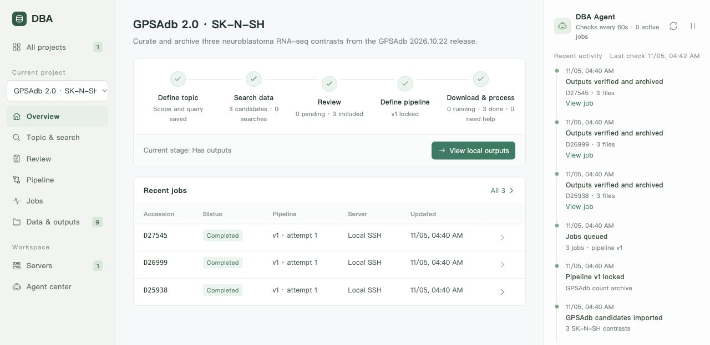

<h1 align="center">DataBaseAgent (DBA)</h1>

<p align="center">
  A local-first, agent-driven workbench for building curated research datasets —<br>
  from literature discovery to remote processing and checksum-verified archives.
</p>

<p align="center">
  
  
  
  
  
</p>

<p align="center">
  <a href="README.zh-CN.md">简体中文</a> ·
  <a href="docs/architecture.md">Architecture</a> ·
  <a href="docs/agents.md">Agents</a> ·
  <a href="docs/models.md">Model Providers</a> ·
  <a href="docs/pipelines.md">Pipelines & Remote Execution</a> ·
  <a href="docs/build.md">Build & Install</a>
</p>

---

DBA turns a research question into a reproducible dataset. You define the topic and inclusion criteria; DBA runs broad literature and repository searches, lets a reviewer agent propose include/exclude decisions backed by verbatim evidence, locks an immutable processing pipeline, dispatches jobs to your Linux servers over SSH, supervises them with bounded automatic recovery, and archives every output locally with SHA-256 verification and a machine-readable provenance manifest.

Everything runs on your machine. DBA writes workspace state to a single JSON file atomically and saves API keys in the system credential store. The AI assistant reads and modifies workspace data through role-scoped tools backed by the same validated commands as the manual pages.

<p align="center"></p>

## Design principles

| Principle | What it means in practice |
| --- | --- |
| **A goal can drive the workflow** | Agents can record decisions, configure pipelines and create or resume jobs through validated tools. Manual pages remain available, and decisions retain their reasons and actor. |
| **Evidence or it did not happen** | A reviewer suggestion is only stored if its quoted evidence appears verbatim in the title or abstract; otherwise it is downgraded to *uncertain*. |
| **Immutable execution snapshots** | A job carries a frozen copy of its pipeline version, input record and server. Editing the draft never alters running or past jobs. |
| **Bounded, observable recovery** | Only a short allow-list of network-class failures is retried, with exponential back-off and a hard cap. Everything else — unknown state, command errors, exhausted retries — becomes a help request with the full log attached. |
| **Least-privilege agents** | Each preset agent has a fixed tool scope. Project commands resolve a project ID and validate record membership; tool results are treated as untrusted data. |
| **Local, atomic, inspectable state** | One `workbench.json`, written via temp-file + rename with transactional rollback; results live in plain directories with per-file checksums and a `run_manifest.json`. |

## How it works

```
 ┌──────────┐   ┌─────────────┐   ┌──────────────┐   ┌───────────────┐   ┌───────────────┐   ┌──────────────┐
 │  Define  │ → │ Broad search│ → │ Evidence-    │ → │ Lock pipeline │ → │ Remote jobs   │ → │ Verified     │
 │  topic   │   │ EPMC/PubMed │   │ backed review│   │ (versioned)   │   │ via SSH, with │   │ local archive│
 │ criteria │   │ GEO / import│   │ AI / manual  │   │               │   │ supervision   │   │ + manifest   │
 └──────────┘   └─────────────┘   └──────────────┘   └───────────────┘   └───────────────┘   └──────────────┘
```

```
                       ┌──────────────────────────── Desktop (Wails v3) / Browser preview ────────────────────────────┐
                       │  Vanilla HTML/CSS/JS · 10 views · polls /api/state · zero npm dependencies                   │
                       └───────────────────────────────────────────┬──────────────────────────────────────────────────┘
                                                                   │ loopback HTTP, same-origin enforced
 ┌─────────────────────────────────────────────────────────────────▼─────────────────────────────────────────────────┐
 │  Go core (internal/workbench)                                                                                     │
 │                                                                                                                   │
 │   Store ── atomic JSON state, schema migration, transactional updates                                             │
 │   Service ─ command dispatcher, validation, quotas, pipeline locking                                              │
 │   Loop ──── scheduler tick: dispatch · poll · classify failures · retry · sync · escalate                          │
 │   Discovery  Europe PMC · PubMed · GEO adapters, cursor paging, de-duplication                                     │
 │   Agents ── bounded tool-use loop · 5 preset personas · read/write tools · per-call trace                         │
 │   LLM ───── protocol adapters: OpenAI Chat Completions · Anthropic Messages · Google Gemini                        │
 │   Executor  SSH: idempotent submission, nohup, exit-code marker, resumable transfer, SHA-256                       │
 └─────────────────────────────────────┬──────────────────────────────────────┬──────────────────────────────────────┘
                                       │ ssh (BatchMode, strict host keys)    │ HTTPS (proxy-aware)
                              ┌────────▼────────┐                    ┌────────▼────────┐
                              │ Linux compute   │                    │ LLM endpoints · │
                              │ nodes           │                    │ EPMC · NCBI     │
                              └─────────────────┘                    └─────────────────┘
```

## Feature highlights

- **Multi-project workspace** — independent topic, search strategy, review ledger, pipeline versions and artifacts per project; cross-project server quotas.
- **Discovery adapters** — Europe PMC (cursor paging), PubMed (E-utilities), GEO (DataSets) and JSON import; hit count vs. fetched count recorded per search, automatic merge on normalized title / DOI / accession.
- **Evidence-verified review** — suggestions carry a confidence level and a quote that is checked verbatim against the source text before being stored.
- **Versioned pipelines** — shell steps with named tools, CPU and concurrency budgets, declared outputs; locking produces an immutable version that jobs bind to.
- **Supervised remote execution** — idempotent submission markers, durable exit codes, PID liveness checks, transient-failure classification, exponential back-off, help requests with resume-from-phase.
- **Verified archive** — per-file SHA-256, resumable transfer with `.partial` files, 100 GiB per-file ceiling, path confinement on both ends, `run_manifest.json` provenance.
- **Agent team** — five preset personas with distinct icons, tool scopes and models; a tool-use loop with step budgets, forced final answers and a persisted trace of every call.
- **Provider-agnostic LLM layer** — one neutral conversation model, three wire protocols, per-agent model selection and direct API key entry.
- **Local & portable** — single binary, embedded assets, no database server, works offline except for discovery and model calls.

## Agents

| Agent | Icon | Purpose | Tools |
| --- | --- | --- | --- |
| Project Assistant | 🤖 | Executes the complete workflow from a goal | all application tools |
| Search Strategist | 🧭 | Saves search strategy, runs discovery and imports candidates | project, search, import |
| Reviewer | 📋 | Records decisions, reasons and known sample groups; also powers batch suggestions | project, candidates, review |
| Pipeline Advisor | 🔀 | Configures, locks and launches pipelines | project, pipeline, servers, jobs |
| Operations Inspector | 🔧 | Checks servers, configures monitoring and resumes resolved jobs | jobs, servers, settings, events, outputs |

Each project has one conversation on the **AI assistant** page, led by the Project Assistant. Type `@` or click **@ Subagent** to mention `@scout`, `@reviewer`, `@pipeline` or `@operator`; the main agent can also delegate autonomously. Specialists use their own models and scoped tools. Their results and traces stay in expandable task cards in the shared conversation, and the main agent summarizes and continues. Multiple mentions run sequentially, with at most eight child tasks per turn and no recursive delegation. Existing role histories appear together without data migration. Click role cards in **Agent center** to configure them.

The right panel retains work progress, monitoring and help requests. Other pages show the same state and support manual edits. Workspace chat can start before a project exists.

Each agent runs a bounded loop: *model → tool calls → results → model*, up to a configurable step budget, after which a final answer is forced. Every tool invocation (arguments, result excerpt, latency, error flag) is stored with the reply and can be expanded in the chat. See [docs/agents.md](docs/agents.md).

## Model providers

| Protocol | Works with | Endpoint DBA calls |
| --- | --- | --- |
| `openai` — Chat Completions | OpenAI, DeepSeek, Qwen, Ollama, vLLM, OpenRouter, LM Studio, any compatible gateway | `{base}/chat/completions` |
| `anthropic` — Messages | Anthropic API and compatible proxies | `{base}/messages` |
| `gemini` — generateContent | Google AI Studio / Gemini API | `{base}/models/{model}:generateContent` |

Add model profiles in **Preferences** and enter the API key directly. Leave the key blank for services that run without authentication. Existing profiles can still read keys from their configured environment variables. [Model provider guide](docs/models.md)

## Quick start

**Prerequisites:** Go 1.26+ to build; an `ssh` client for remote execution; platform WebView (WebView2 on Windows, WebKit on macOS, GTK4 + WebKitGTK on Linux). No Node.js, no C toolchain for Windows builds.

Run the browser preview (same backend, same UI, no native toolchain):

```bash
go run ./cmd/dba-server -port 3415 -workspace .tmp/dev-workspace
```

Build the desktop app for the current platform:

```bash
scripts/build.sh
```

Windows:

```powershell
./scripts/build.ps1
```

Installers, cross-compilation and workspace locations are covered in [docs/build.md](docs/build.md).

### GPSAdb example

GPSAdb 2.0 curates human cell-line RNA-seq datasets for single-gene perturbations. The `2026.10.22` data release contains 7,665 datasets and 42,235 samples covering 2,810 perturbed genes. [GPSAdb 2.0 paper](https://doi.org/10.1093/nar/gkaf1077) · [Versioned data release](https://doi.org/10.5281/zenodo.23585244)

The screenshot shows a DBA project archiving three SK-N-SH contrasts from that release. A locked pipeline checks the published sample assignments against the count columns and archives the count matrix, sample sheet and per-sample summaries for each contrast. [PLLP](https://gpsadb.gzdlab.com/dataset/D25938) · [SUV39H1](https://gpsadb.gzdlab.com/dataset/D26999) · [TSPYL5](https://gpsadb.gzdlab.com/dataset/D27545)

The companion manuscript case follows a FAM167A knockdown from GEO screening through a help request, human-confirmed sample groups and checksum-verified archiving. [Reproduce the case](docs/manuscript/gpsadb-case/README.md) · [DBA workflow guide](docs/workflow.md)

## Documentation

| Document | Covers |
| --- | --- |
| [docs/architecture.md](docs/architecture.md) | Components, data model, job state machine, persistence, security boundaries |
| [docs/agents.md](docs/agents.md) | Agent loop, presets, tool catalogue, guardrails, trace format, customization |
| [docs/models.md](docs/models.md) | Protocol adapters, request mapping, keys, proxies, provider recipes |
| [docs/discovery.md](docs/discovery.md) | Search adapters, paging, limits, de-duplication, import format |
| [docs/pipelines.md](docs/pipelines.md) | Pipeline contract, environment variables, remote protocol, recovery, sync, manifest |
| [docs/build.md](docs/build.md) | Platform matrix, build scripts, installers, cross-compilation, workspaces |
| [docs/workflow.md](docs/workflow.md) | End-to-end user guide, current scope and non-goals |

## Verification

```bash
go test ./... && go vet ./... && node --check frontend/workbench.js
```

The suite exercises project isolation, the recorded-inclusion gate, immutable pipeline snapshots, cross-project server quotas, no-resubmission on lost acknowledgements, bounded recovery and hand-off, transfer recovery without re-execution, restart resumption, persistence rollback and corruption detection, discovery de-duplication and fetch limits, evidence verification, same-origin enforcement, agent tool scoping and tracing, all three model protocols, schema migration, conversation-driven workflows and retained traces after failures — using a controllable executor and a stubbed HTTP transport. Real servers and model endpoints still need to be validated with your own configuration.

## Scope

This is a working first release aimed at closing the single-server loop end to end. The executor is plain SSH on Linux (no Slurm, containers or memory/disk quotas); CPU budgets govern dispatch capacity, not thread counts. Remote processes keep running when DBA is closed and are re-attached on relaunch. Agents can save and lock pipeline changes through tools; existing jobs retain their frozen commands. See [docs/workflow.md#scope-and-non-goals](docs/workflow.md#scope-and-non-goals) for the full list.

## Repository layout

```
main.go                 Wails desktop entry point (single-instance, workspace flag)
cmd/dba-server/         Browser preview server bound to 127.0.0.1
internal/workbench/     Core: store · service · loop · discovery · agent · llm · ssh · http
frontend/               Embedded UI: index.html · styles.css · workbench.js
assets/                 README screenshots
scripts/                build.sh · build.ps1 · installer.nsi
docs/                   Topic documentation
design/                 Original design package with checksums
```
