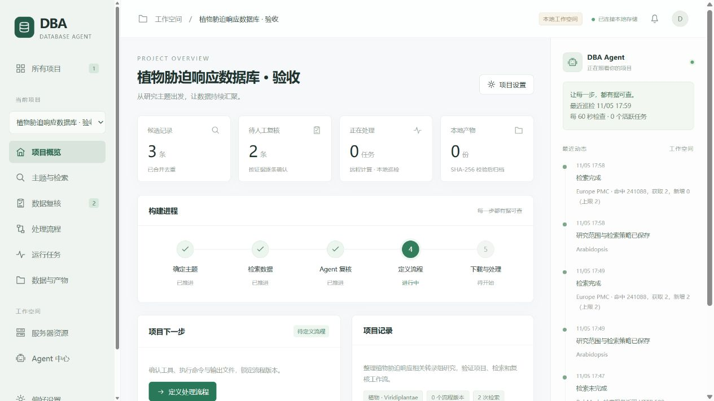

<h1 align="center">DataBaseAgent (DBA)</h1>

<p align="center">
  A local-first, human-in-the-loop workbench for building curated research datasets —<br>
  from literature discovery to remote processing and checksum-verified archives.
</p>

<p align="center">
  
  
  
  
  
</p>

<p align="center">
  <a href="README.zh-CN.md">简体中文</a> ·
  <a href="docs/architecture.md">Architecture</a> ·
  <a href="docs/agents.md">Agents</a> ·
  <a href="docs/models.md">Model Providers</a> ·
  <a href="docs/pipelines.md">Pipelines & Remote Execution</a> ·
  <a href="docs/build.md">Build & Install</a>
</p>

---

DBA turns a research question into a reproducible dataset. You define the topic and inclusion criteria; DBA runs broad literature and repository searches, lets a reviewer agent propose include/exclude decisions backed by verbatim evidence, locks an immutable processing pipeline, dispatches jobs to your Linux servers over SSH, supervises them with bounded automatic recovery, and archives every output locally with SHA-256 verification and a machine-readable provenance manifest.

Everything runs on your machine. State is a single atomically-written JSON file; credentials never touch disk; the LLM only ever reads project data through scoped tools and never executes anything.

<p align="center"></p>

## Design principles

| Principle | What it means in practice |
| --- | --- |
| **Human gates on every irreversible step** | Inclusion decisions, sample grouping, pipeline changes and job resumption are user actions. Agents suggest; they never decide. |
| **Evidence or it did not happen** | A reviewer suggestion is only stored if its quoted evidence appears verbatim in the title or abstract; otherwise it is downgraded to *uncertain*. |
| **Immutable execution snapshots** | A job carries a frozen copy of its pipeline version, input record and server. Editing the draft never alters running or past jobs. |
| **Bounded, observable recovery** | Only a short allow-list of network-class failures is retried, with exponential back-off and a hard cap. Everything else — unknown state, command errors, exhausted retries — becomes a help request with the full log attached. |
| **Least-privilege agents** | Each preset agent has a fixed set of read-only tools scoped to the current project. Tool results are treated as untrusted data. |
| **Local, atomic, inspectable state** | One `workbench.json`, written via temp-file + rename with transactional rollback; results live in plain directories with per-file checksums and a `run_manifest.json`. |

## How it works

```
 ┌──────────┐   ┌─────────────┐   ┌──────────────┐   ┌───────────────┐   ┌───────────────┐   ┌──────────────┐
 │  Define  │ → │ Broad search│ → │ Evidence-    │ → │ Lock pipeline │ → │ Remote jobs   │ → │ Verified     │
 │  topic   │   │ EPMC/PubMed │   │ backed review│   │ (versioned)   │   │ via SSH, with │   │ local archive│
 │ criteria │   │ GEO / import│   │ human decides│   │               │   │ supervision   │   │ + manifest   │
 └──────────┘   └─────────────┘   └──────────────┘   └───────────────┘   └───────────────┘   └──────────────┘
```

```
                       ┌──────────────────────────── Desktop (Wails v3) / Browser preview ────────────────────────────┐
                       │  Vanilla HTML/CSS/JS · 10 views · polls /api/state · zero npm dependencies                   │
                       └───────────────────────────────────────────┬──────────────────────────────────────────────────┘
                                                                   │ loopback HTTP, same-origin enforced
 ┌─────────────────────────────────────────────────────────────────▼─────────────────────────────────────────────────┐
 │  Go core (internal/workbench)                                                                                     │
 │                                                                                                                   │
 │   Store ── atomic JSON state, schema migration, transactional updates                                             │
 │   Service ─ command dispatcher, validation, quotas, pipeline locking                                              │
 │   Loop ──── scheduler tick: dispatch · poll · classify failures · retry · sync · escalate                          │
 │   Discovery  Europe PMC · PubMed · GEO adapters, cursor paging, de-duplication                                     │
 │   Agents ── bounded tool-use loop · 5 preset personas · 9 read-only tools · per-call trace                         │
 │   LLM ───── protocol adapters: OpenAI Chat Completions · Anthropic Messages · Google Gemini                        │
 │   Executor  SSH: idempotent submission, nohup, exit-code marker, resumable transfer, SHA-256                       │
 └─────────────────────────────────────┬──────────────────────────────────────┬──────────────────────────────────────┘
                                       │ ssh (BatchMode, strict host keys)    │ HTTPS (proxy-aware)
                              ┌────────▼────────┐                    ┌────────▼────────┐
                              │ Linux compute   │                    │ LLM endpoints · │
                              │ nodes           │                    │ EPMC · NCBI     │
                              └─────────────────┘                    └─────────────────┘
```

## Feature highlights

- **Multi-project workspace** — independent topic, search strategy, review ledger, pipeline versions and artifacts per project; cross-project server quotas.
- **Discovery adapters** — Europe PMC (cursor paging), PubMed (E-utilities), GEO (DataSets) and JSON import; hit count vs. fetched count recorded per search, automatic merge on normalized title / DOI / accession.
- **Evidence-verified review** — suggestions carry a confidence level and a quote that is checked verbatim against the source text before being stored.
- **Versioned pipelines** — shell steps with named tools, CPU and concurrency budgets, declared outputs; locking produces an immutable version that jobs bind to.
- **Supervised remote execution** — idempotent submission markers, durable exit codes, PID liveness checks, transient-failure classification, exponential back-off, help requests with resume-from-phase.
- **Verified archive** — per-file SHA-256, resumable transfer with `.partial` files, 100 GiB per-file ceiling, path confinement on both ends, `run_manifest.json` provenance.
- **Agent team** — five preset personas with distinct icons, tool scopes and models; a tool-use loop with step budgets, forced final answers and a persisted trace of every call.
- **Provider-agnostic LLM layer** — one neutral conversation model, three wire protocols, per-agent model selection, keys read from environment variables only.
- **Local & portable** — single binary, embedded assets, no database server, works offline except for discovery and model calls.

## Agents

| Agent | Icon | Purpose | Tools |
| --- | --- | --- | --- |
| Project Assistant | 🤖 | Explains the current stage and what to do next | all nine read-only tools |
| Search Strategist | 🧭 | Evaluates recall/noise and proposes better query expressions | project, searches, candidates |
| Reviewer | 📋 | Include/exclude suggestions with verbatim evidence; also powers batch review | project, candidates |
| Pipeline Advisor | 🔀 | Reviews steps, commands, resource budgets and output contracts | project, pipeline, servers, jobs |
| Operations Inspector | 🔧 | Reads job logs and server state, diagnoses failures, proposes fixes | jobs, servers, events |

Each agent runs a bounded loop: *model → tool calls → results → model*, up to a configurable step budget, after which a final answer is forced. Every tool invocation (arguments, result excerpt, latency, error flag) is stored with the reply and can be expanded in the chat. See [docs/agents.md](docs/agents.md).

## Model providers

| Protocol | Works with | Endpoint DBA calls |
| --- | --- | --- |
| `openai` — Chat Completions | OpenAI, DeepSeek, Qwen, Ollama, vLLM, OpenRouter, LM Studio, any compatible gateway | `{base}/chat/completions` |
| `anthropic` — Messages | Anthropic API and compatible proxies | `{base}/messages` |
| `gemini` — generateContent | Google AI Studio / Gemini API | `{base}/models/{model}:generateContent` |

Add any number of model profiles in **Preferences**, then pick one per agent. API keys are referenced by environment-variable name and read at request time; local servers may run without a key. See [docs/models.md](docs/models.md).

## Quick start

**Prerequisites:** Go 1.26+ to build; an `ssh` client for remote execution; platform WebView (WebView2 on Windows, WebKit on macOS, GTK4 + WebKitGTK on Linux). No Node.js, no C toolchain for Windows builds.

Run the browser preview (same backend, same UI, no native toolchain):

```bash
go run ./cmd/dba-server -port 3415 -workspace .tmp/dev-workspace
```

Build the desktop app for the current platform:

```bash
scripts/build.sh
```

Windows:

```powershell
./scripts/build.ps1
```

Installers, cross-compilation and workspace locations are covered in [docs/build.md](docs/build.md).

**First project in five minutes**

1. Create a project; write the research goal, inclusion criteria and a deliberately broad query.
2. Run a search against Europe PMC, PubMed or GEO (or import JSON). Hits are merged and de-duplicated.
3. Add a model in Preferences, let the Reviewer propose decisions, verify the quoted evidence, then include or exclude with a written reason.
4. Register a Linux server (key-based SSH, strict host checking) and run the connection check.
5. Define pipeline steps and outputs, lock the version, queue jobs. The scheduler dispatches within quotas, supervises, retries transient failures, escalates the rest, and archives verified outputs.

Full walkthrough: [docs/workflow.md](docs/workflow.md).

## Documentation

| Document | Covers |
| --- | --- |
| [docs/architecture.md](docs/architecture.md) | Components, data model, job state machine, persistence, security boundaries |
| [docs/agents.md](docs/agents.md) | Agent loop, presets, tool catalogue, guardrails, trace format, customization |
| [docs/models.md](docs/models.md) | Protocol adapters, request mapping, keys, proxies, provider recipes |
| [docs/discovery.md](docs/discovery.md) | Search adapters, paging, limits, de-duplication, import format |
| [docs/pipelines.md](docs/pipelines.md) | Pipeline contract, environment variables, remote protocol, recovery, sync, manifest |
| [docs/build.md](docs/build.md) | Platform matrix, build scripts, installers, cross-compilation, workspaces |
| [docs/workflow.md](docs/workflow.md) | End-to-end user guide, current scope and non-goals |

## Verification

```bash
go test ./... && go vet ./... && node --check frontend/workbench.js
```

The suite exercises project isolation, the human-review gate, immutable pipeline snapshots, cross-project server quotas, no-resubmission on lost acknowledgements, bounded recovery and hand-off, transfer recovery without re-execution, restart resumption, persistence rollback and corruption detection, discovery de-duplication and fetch limits, evidence verification, same-origin enforcement, agent tool scoping and tracing, all three model protocols, and schema migration — using a controllable executor and a stubbed HTTP transport. Real servers and model endpoints still need to be validated with your own configuration.

## Scope

This is a working first release aimed at closing the single-server loop end to end. The executor is plain SSH on Linux (no Slurm, containers or memory/disk quotas); CPU budgets govern dispatch capacity, not thread counts. Remote processes keep running when DBA is closed and are re-attached on relaunch. Agents are read-only and never rewrite commands. See [docs/workflow.md#scope-and-non-goals](docs/workflow.md#scope-and-non-goals) for the full list.

## Repository layout

```
main.go                 Wails desktop entry point (single-instance, workspace flag)
cmd/dba-server/         Browser preview server bound to 127.0.0.1
internal/workbench/     Core: store · service · loop · discovery · agent · llm · ssh · http
frontend/               Embedded UI: index.html · styles.css · workbench.js
scripts/                build.sh · build.ps1 · installer.nsi
docs/                   Topic documentation
design/                 Original design package with checksums
```
