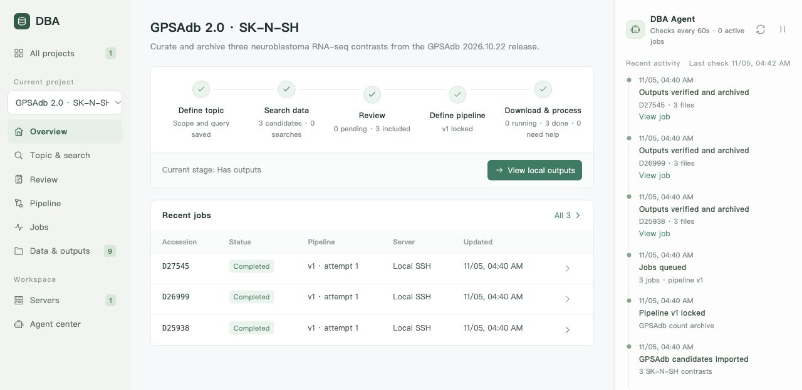

> English: [README.md](README.md) · 专题文档：[docs/](docs/)（架构、Agent、模型协议、检索、流程与远程执行、构建与安装、使用指南与边界）

# DataBaseAgent（DBA）

基于 **Wails v3.1.0 + Go + 原生 HTML/CSS/JavaScript** 的本地主题数据库构建工作台。十个页面沿用提供的设计包：所有项目、项目概览、主题与检索、数据复核、处理流程、运行任务、服务器资源、数据与产物、Agent 中心、偏好设置。

<p align="center"></p>

## 运行与构建

从源码构建需要 Go 1.26+；前端没有 npm 依赖，静态资源直接嵌入可执行文件。远程执行在任何平台都需要系统 `ssh` 客户端（Windows 为内置 OpenSSH）。

| 平台 | 运行时依赖 | 本机构建额外依赖 | 产物 |
| --- | --- | --- | --- |
| Windows 10/11 | WebView2 Runtime（Windows 11 自带） | 无 | `bin/DBA.exe` |
| macOS 12+（Go 1.26）或 macOS 13+（Go 1.27） | 系统 WebKit | Xcode 命令行工具：`xcode-select --install` | `bin/DBA.app` |
| Linux | GTK 4 与 WebKitGTK 6.0 | 对应开发包，Debian/Ubuntu 为 `libgtk-4-dev libwebkitgtk-6.0-dev`，Fedora 为 `gtk4-devel webkitgtk6.0-devel` | `bin/DBA` |

macOS / Linux：

```bash
scripts/build.sh
```

```bash
scripts/build.sh all
```

Windows（PowerShell）：

```powershell
./scripts/build.ps1
```

```powershell
./scripts/build.ps1 -Target all
```

两个脚本都接受 `windows`、`darwin`、`linux`、`all` 目标；`all` 一次产出三个平台的成品。`--debug` / `-Debug` 不剥离符号并启用 Wails 开发特性。`GOARCH=arm64` 可切换 Windows / Linux 架构，`TAGS=gtk3` 让 Linux 成品改用 GTK 3 + WebKit2GTK 4.1（旧发行版没有 WebKitGTK 6.0 时使用）。

安装包：

```bash
scripts/build.sh setup
```

```bash
scripts/build.sh dmg
```

`setup` 生成 `bin/DBA-Setup.exe`（PowerShell 为 `./scripts/build.ps1 -Target setup`），需要 NSIS 3 的 `makensis` 在 PATH 中：macOS `brew install makensis`，Debian/Ubuntu `apt install nsis`，Windows 从 [nsis.sourceforge.io](https://nsis.sourceforge.io) 安装。安装包按用户安装到 `%LOCALAPPDATA%\Programs\DBA`，不需要管理员权限，写入开始菜单与「应用和功能」卸载项；缺少 WebView2 Runtime 时提示下载；卸载不删除 `%APPDATA%\DataBaseAgent` 工作空间。安装脚本在 `scripts/installer.nsi`。

`dmg` 生成 `bin/DBA.dmg`，内含 `DBA.app` 和 `Applications` 快捷方式，只能在 macOS 上用系统自带的 `hdiutil` 生成。两种安装包都未签名：macOS 需要右键「打开」或 `xattr -dr com.apple.quarantine`，Windows SmartScreen 可能提示「更多信息 → 仍要运行」。

交叉编译规则：Windows 目标是纯 Go，在任何平台都能构建。为非本机平台构建 macOS 或 Linux 时，脚本切换到 Wails 的 purego 后端（`CGO_ENABLED=0 -tags purego`），不需要 C 工具链，但 Wails 将其标为实验特性；正式发布请在目标平台本机构建。`PUREGO=1 scripts/build.sh` 可在本机也省掉 C 工具链。`build.ps1` 在未设置 `HTTPS_PROXY` 时默认走 `http://127.0.0.1:7897` 代理下载模块，`build.sh` 只沿用当前环境变量。

默认工作空间：Windows `%APPDATA%\DataBaseAgent`，macOS `~/Library/Application Support/DataBaseAgent`，Linux `~/.config/DataBaseAgent`，保存 `workbench.json` 与 `projects/<项目ID>/results/<任务ID>/`。用 `-workspace <目录>` 指定其他目录，macOS 为 `open bin/DBA.app --args -workspace <目录>`。同一工作空间的桌面实例复用现有窗口。

浏览器开发预览使用同一个后端和同一套静态资源，任何平台都不需要 C 工具链：

```bash
go run ./cmd/dba-server -port 3415 -workspace .tmp/dev-workspace
```

服务仅监听 `127.0.0.1`。请勿让开发服务和桌面端同时使用同一工作空间。原始设计保存在 `design/DBA_design_package/`，包括未经修改的 HTML 和校验清单。

## 使用路径：以 GPSAdb 为例

GPSAdb 2.0 收录人类细胞系的单基因扰动 RNA-seq 数据。`2026.10.22` 发布版包含 7,665 个数据集、42,235 个样本，覆盖 2,810 个被扰动的基因。 [GPSAdb 2.0 论文](https://doi.org/10.1093/nar/gkaf1077) · [数据发布记录](https://doi.org/10.5281/zenodo.23585244)

首页英文截图展示了该发布版中 SK-N-SH 细胞的三组扰动对比。DBA 用锁定的流程核对样本分组与计数列，再归档每组对比的计数矩阵、分组表和样本汇总。 [PLLP](https://gpsadb.gzdlab.com/dataset/D25938) · [SUV39H1](https://gpsadb.gzdlab.com/dataset/D26999) · [TSPYL5](https://gpsadb.gzdlab.com/dataset/D27545)

手稿案例另以 FAM167A 敲低为例，展示如何从 GEO 筛选候选、处理分组求助并校验归档。 [复现步骤](docs/manuscript/gpsadb-case/README.md) · [DBA 工作流指南](docs/workflow.md)

## Agent 与模型

Agent 采用主流的工具调用循环：模型根据对话决定调用哪些只读工具（项目范围、候选、检索历史、流程、服务器、任务日志、事件），应用执行后把结果回填，循环直到模型给出结论或达到步数上限；每次工具调用的参数、结果与耗时都记录在消息中，可在对话里展开核对。工具只能读取当前项目，模型没有执行命令或修改数据的权限，纳入、分组和流程变更仍由用户确认。

预设五个角色，工具范围固定、指令和模型可改：项目助手（全局解释）、检索策略师（改进检索式）、复核员（纳入建议与证据，也负责批量复核）、流程顾问（审阅步骤与命令）、运维巡检员（读取日志诊断失败）。在右侧栏切换角色对话；任务详情和求助请求提供“让运维巡检员诊断”。

在偏好设置页添加模型：选择协议、填写 API 基础地址、模型 ID 和 API Key 环境变量名（本地服务可留空）。支持三种协议：OpenAI Chat Completions 兼容（追加 `/chat/completions`，涵盖 DeepSeek、Qwen、Ollama、vLLM 等）、Anthropic Messages（追加 `/messages`）和 Google Gemini（追加 `/models/{模型}:generateContent`）。每个 Agent 可选择不同模型，未选择时使用列表中的第一个。密钥只从进程环境读取，不写入项目文件，例如先设置 `$env:DBA_MODEL_API_KEY` 再从同一终端启动应用。

检索和模型 HTTP 请求遵循启动进程的 `HTTP_PROXY` / `HTTPS_PROXY` 环境变量。GitHub 操作及构建脚本使用 `http://127.0.0.1:7897` 代理。SSH 采用本机密钥或 SSH Agent，强制校验已知主机，不支持交互式密码输入。

## 当前边界

这是可运行的第一版，使用本地 JSON 原子保存，适合先贯通单服务器闭环。执行器目前支持 Linux SSH，不含 Slurm、容器管理、内存/磁盘硬配额或系统服务。CPU 配额控制提交容量，实际线程数须在工具参数中设置。关闭 DBA 后远端进程继续运行；重新打开后恢复巡检。巡检循环按固定恢复策略工作；Agent 对话只读，不自动改写分析命令。旧版（schema 1）工作空间打开时自动迁移模型配置。

新版本不会自动套用到旧任务；终止或删除远端任务、编辑服务器配置、按时间段穷尽海量检索结果等功能尚未提供。失败后的求助允许补充分组或在远端修复环境；需要修改工具或参数时，应锁定新流程并提交新任务。SSH 远端需要 `sh`、`nohup`、`realpath`、`sha256sum` 和所选工具。原始数据下载由已确认的流程命令完成，不会从任意论文自动推断完整 FASTQ 下载方案。

## 验证

```bash
go test ./... && go vet ./... && node --check frontend/workbench.js
```

测试覆盖项目隔离、人工纳入门槛、流程与输入快照、跨项目服务器配额、连接失败不重复提交、有限恢复和人工接手、校验与本地归档、重启持久化、损坏文件保护、检索去重与获取上限、模型证据校验、HTTP 来源检查、Agent 工具范围与调用痕迹、三种模型协议的请求与回填格式，以及旧工作空间迁移。自动化测试通过可控执行器验证调度闭环；真实服务器和模型端点仍须使用自己的配置完成联调。
