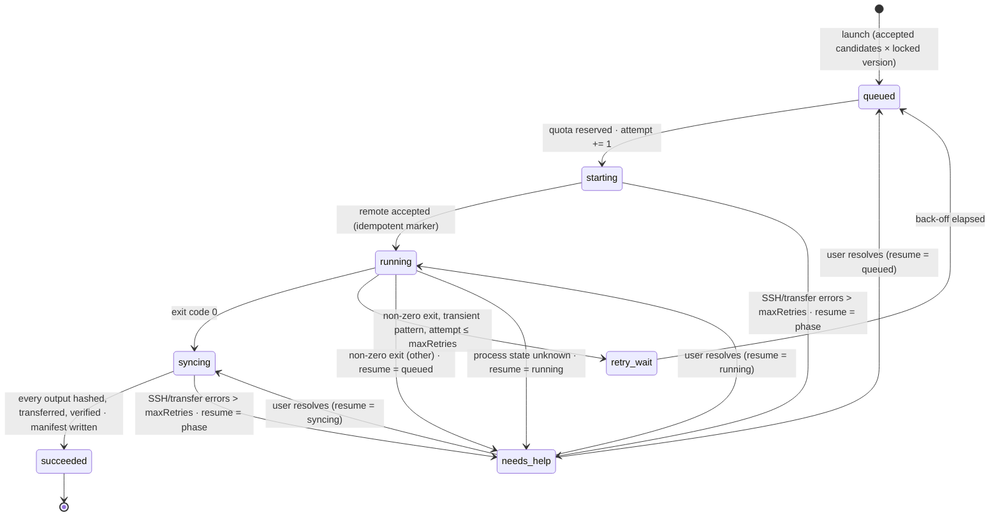

# Architecture

DBA is a single Go binary with an embedded web UI. There is no database server, no message queue and no background daemon: the scheduler, the agent runtime and the SSH executor all live inside the desktop process (or inside the browser-preview server during development).

## Components

| Component | File | Responsibility |
| --- | --- | --- |
| Store | `internal/workbench/store.go` | Owns the in-memory `State`, serializes it to `workbench.json` atomically, performs schema migration on open, rolls back failed transactions. |
| Service | `internal/workbench/service.go` | Dispatches UI commands (`createProject`, `review`, `lockPipeline`, `launch`, `saveModel`, …), validates input, enforces quotas and the recorded-inclusion gate. |
| Loop | `internal/workbench/loop.go` | The supervision loop: wakes every `intervalSeconds`, observes in-flight jobs, dispatches queued jobs within quotas, classifies failures, schedules retries, escalates to help requests, archives results. |
| Discovery | `internal/workbench/discovery.go` | Europe PMC, PubMed and GEO adapters; paging, rate limiting, candidate normalization and de-duplication. |
| Agents | `internal/workbench/agent.go` | Preset personas, read tools and validated command tools (`agent_tools.go`), the bounded tool-use loop, chat history and the batch reviewer. |
| LLM | `internal/workbench/llm.go` | Protocol adapters that translate a neutral conversation model to OpenAI Chat Completions, Anthropic Messages and Gemini generateContent. |
| Executor | `internal/workbench/ssh.go` | The `Executor` interface and its SSH implementation: probe, idempotent start, poll, resumable verified sync. |
| HTTP | `internal/workbench/http.go` | Serves embedded assets and the JSON API; enforces same-origin, JSON-only POSTs and a 4 MiB body limit. |
| Frontend | `frontend/workbench.js` | A single vanilla-JS file rendering ten views from the state snapshot; polls `/api/state` every 3 s and re-renders only when the snapshot changes and no field is being edited. |

The desktop shell (`main.go`) wires `Store → Service → Loop` and hands the HTTP handler to Wails as the asset handler. `cmd/dba-server` does the same behind `net/http` on `127.0.0.1` for browser development; both share every line of application code.

## Data model

All entities live in one `State` document (schema version 2):

```
State
├── Projects[]      topic, criteria, query, source
│   ├── Candidates[]   title, abstract, accession, DOI, URL, downloadUrl, organism, year,
│   │                  suggestion / confidence / reason / evidence (agent),
│   │                  decision / reviewNote / groups / reviewedAt / reviewedBy (user or agent)
│   ├── Searches[]     query, source, total hits, fetched, added, timestamp
│   ├── Draft          editable Pipeline
│   ├── Versions[]     locked, immutable Pipelines (monotonic version numbers)
│   └── Messages[]     agent conversations with per-call Trace
├── Servers[]       host, port, user, key path, work dir, CPU quota, max jobs, probe result
├── Jobs[]          frozen copies of input Candidate + Pipeline + Server, status, attempt,
│                   failures, retryAt, remoteDir, log tail, error, help, resumeStatus
├── Artifacts[]     name, local path, SHA-256, size, job/project/accession
├── Messages[]      workspace conversations (before selecting a project)
├── Events[]        audit trail (capped at 2000), kinds: user · search · review · queue ·
│                   dispatch · repair · help · sync · success · server · agent · error
└── Settings        paused, intervalSeconds, maxRetries, Models[], Agents[]
```

Jobs are *snapshots*: when a job is queued it copies the candidate, the locked pipeline version and the server configuration. Later edits to any of them never affect the job. The pair (candidate id, pipeline version id) is unique per project, which is what prevents accidental double submission.

## Job state machine



Two counters are kept apart on purpose:

- `attempt` counts remote *executions*. It only increases when a job leaves `queued`, and each attempt gets its own remote directory (`attempt-N`).
- `failures` counts consecutive *operational* errors (SSH timeouts, transfer errors) within one phase. They never cause re-execution; the job stays in its phase and is retried with back-off, then escalated with `resumeStatus` set to that phase so the user can resume exactly where it stopped.

Back-off is `min(300, 10 × 2^min(n,5))` seconds: 20 s, 40 s, 80 s, 160 s, then 300 s.

## Scheduler tick

1. A `time.Ticker` fires every 2 s; a tick runs only when `intervalSeconds` have elapsed since the last tick and the loop is not paused. Ticks are mutually exclusive (`TryLock`).
2. `retry_wait` jobs whose `retryAt` has passed are moved back to `queued`.
3. Existing work is observed first: every `starting` / `running` / `syncing` job not currently in flight and not waiting on back-off gets a goroutine (`operate`). At most 8 operations run concurrently.
4. Only then are `queued` jobs dispatched. Reservation is a single transactional update that checks the server's `maxJobs` and `cpuQuota` and the pipeline's per-project `concurrency` against all in-flight jobs (including help requests whose resume phase is active). If any budget is exceeded, the job simply stays queued.
5. Per-operation timeouts: 45 s for start/poll, 30 min for sync.

Shutdown cancels the service context; an operation that fails because of shutdown does not mutate state, so the next launch resumes from the last durable snapshot.

## Persistence

- Every mutation goes through `Store.Update(fn)`. The previous state is captured, `fn` runs, and on error the state is restored byte-for-byte.
- On success the whole document is marshalled, written to a temp file in the workspace, fsynced, and renamed over `workbench.json`. A crash leaves either the old or the new file, never a mix.
- `Open` refuses to load a file it cannot parse ("corrupted, original preserved") and refuses unknown schema versions. Schema 1 workspaces (v0.1) are migrated in memory: the flat model settings become a model profile with the `openai` protocol and untagged messages are attributed to the Project Assistant.
- Agent presets are merged on open: canonical order, icons and tool scopes always come from code; the user's instructions, model choice and step budget are preserved.

## Security boundaries

| Boundary | Enforcement |
| --- | --- |
| Network exposure | The preview server binds `127.0.0.1` only. Any request carrying an `Origin` header must match the `Host`, which blocks cross-site POSTs from a browser. |
| Request hygiene | POST bodies must be `application/json` and ≤ 4 MiB; unknown actions are rejected. |
| Credentials | SSH uses `BatchMode=yes` and `StrictHostKeyChecking=yes`, and exports strip private-key paths. DBA stores directly entered model keys in the system credential store and keeps only references in the workspace. Existing model profiles can read their configured environment variable. |
| Paths | Output names must be safe relative paths (`[A-Za-z0-9._-/]`, no `..`, no absolute paths). The remote side re-checks with `realpath` that each file is inside `output/`; the local side confines artifact previews to the workspace. |
| Untrusted content | Titles, abstracts, logs and tool results are passed to models as data with explicit instructions to ignore embedded directives; model output is validated (JSON shape, enum values, verbatim evidence) before anything is stored. |
| Write authority | Role-scoped tools dispatch the same validated Service commands as the UI. Project tools resolve a project ID; candidate/job mutations check membership. No generic shell or recursive chat tool is exposed. |

## Request flow

```
UI action ──POST /api/<action>──▶ Handler ──▶ Service.Dispatch ──▶ Store.Update (validated, atomic)
                                                   │
                                                   ├── search  ──▶ Discovery adapters ──▶ merge candidates
                                                   ├── message ──▶ Agent loop ──▶ LLM adapter ──▶ tools (fresh snapshot / Service commands)
                                                   ├── reviewAgent ──▶ LLM adapter ──▶ evidence check
                                                   └── tick / probe ──▶ Executor (SSH)
UI ◀──GET /api/state (3 s poll)── State snapshot + per-agent readiness + key status
```
