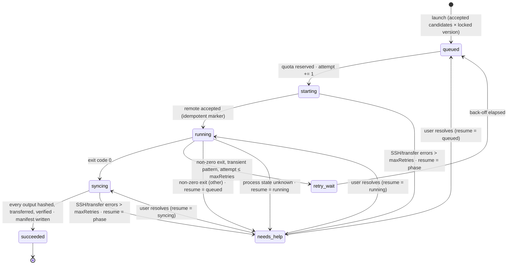

# Architecture

DBA is a single Go binary with an embedded web UI. The scheduler, persistent conversation queue, agent runtime, and SSH executor all live inside the desktop process (or the browser-preview server during development); no external database, queue service, or daemon is required.

## Components

| Component | File | Responsibility |
| --- | --- | --- |
| Store | `internal/workbench/store.go` | Owns the in-memory `State`, serializes it to `workbench.json` atomically, performs schema migration on open, rolls back failed transactions. |
| Service | `internal/workbench/service.go`, `commands.go` | `Dispatch` looks up a named command (`createProject`, `review`, `lockPipeline`, `launch`, `saveModel`, …) in one table. State-only commands run as a single `Store.Update` transaction; commands that reach the network, SSH or the system keychain manage their own locking so slow I/O never holds the state lock. Validation, quotas and the recorded-inclusion gate live in the commands. |
| Approvals | `internal/workbench/approvals.go` | Holds agent tool calls with effects outside the workspace record until the user allows or denies them (see [agents.md](agents.md#approvals-and-boundaries)). |
| Loop | `internal/workbench/loop.go` | The supervision loop: wakes every `intervalSeconds`, observes in-flight jobs, dispatches queued jobs within quotas, classifies failures, schedules retries, escalates to help requests, archives results. |
| Discovery | `internal/workbench/discovery.go` | Europe PMC, PubMed and GEO adapters; paging, rate limiting, candidate normalization and de-duplication. |
| Agents | `internal/workbench/agent.go` | Preset personas, validated command tools (`agent_tools.go`), the bounded tool-use loop, shared project chat and the batch reviewer. `agent_delegation.go` handles mentions and main-agent delegation to specialists. |
| LLM | `internal/workbench/llm.go` | Protocol adapters that translate a neutral conversation model to OpenAI Chat Completions, Anthropic Messages and Gemini generateContent. |
| Conversations | `internal/workbench/conversations.go`, `frontend/conversations.js` | Independent histories, durable message queues, cancellation, crash recovery, drafts, and tool execution timelines. |
| Executor | `internal/workbench/ssh.go` | The `Executor` interface and its SSH implementation: probe, idempotent start, poll, resumable verified sync. |
| HTTP | `internal/workbench/http.go` | Serves embedded assets and the JSON API; enforces same-origin, JSON-only POSTs and a 4 MiB body limit. `/api/state` carries an ETag; the preview server additionally accepts only loopback host names. |
| Examples | `examples/catalog.json`, `internal/workbench/examples.go`, `frontend/examples.js` | Design-demo files embedded in the binary. `/api/examples` returns the catalog with file text, `/api/example-site` renders a static example with the workspace SKILL (the bundled copy if that SKILL is off), and `createExampleProject` adds at most one project per example. |
| Frontend | `frontend/workbench.js`, `frontend/conversations.js` | Vanilla JS rendering the workbench and conversations from state snapshots. Polls `/api/state` every 3 s with `If-None-Match`, so an unchanged workspace answers `304` without serialization or re-rendering; conversation updates preserve draft input and scroll position, including while typing. |

The desktop shell (`main.go`) wires `Store → Service → Loop` and hands the HTTP handler to Wails as the asset handler. `cmd/dba-server` does the same behind `net/http` on `127.0.0.1` for browser development; both share every line of application code.

## Data model

All entities live in one `State` document (schema version 3):

```
State
├── Projects[]      topic, criteria, query, source
│   ├── Candidates[]   title, abstract, accession, DOI, URL, downloadUrl, organism, year,
│   │                  suggestion / confidence / reason / evidence (agent),
│   │                  decision / reviewNote / groups / reviewedAt / reviewedBy (user or agent)
│   ├── Searches[]     query, source, total hits, fetched, added, timestamp
│   ├── Draft          editable Pipeline
│   ├── Versions[]     locked, immutable Pipelines (monotonic version numbers)
│   └── Messages[]     one project conversation, child-task results and per-call Trace
├── Servers[]       host, port, user, key path, work dir, CPU quota, max jobs, probe result
├── Jobs[]          frozen copies of input Candidate + Pipeline + Server, status, attempt,
│                   failures, retryAt, remoteDir, log tail, error, help, resumeStatus
├── Artifacts[]     name, local path, SHA-256, size, job/project/accession
├── Messages[]      workspace conversations (before selecting a project)
├── Conversations[] conversation titles, project/agent scope, pins and archives
├── ChatQueuePaused scope-level queue pause state (requests live in Messages[])
├── Events[]        audit trail (capped at 2000), kinds: user · search · review · queue ·
│                   dispatch · repair · help · sync · success · server · agent · error
└── Settings        paused, intervalSeconds, maxRetries, Models[], Agents[]
```

Jobs are *snapshots*: when a job is queued it copies the candidate, the locked pipeline version and the server configuration. Later edits to any of them never affect the job. The pair (candidate id, pipeline version id) is unique per project, which is what prevents accidental double submission.

## Job state machine



Two counters are kept apart on purpose:

- `attempt` counts remote *executions*. It only increases when a job leaves `queued`, and each attempt gets its own remote directory (`attempt-N`).
- `failures` counts consecutive *operational* errors (SSH timeouts, transfer errors) within one phase. They never cause re-execution; the job stays in its phase and is retried with back-off, then escalated with `resumeStatus` set to that phase so the user can resume exactly where it stopped.

Back-off is `min(300, 10 × 2^min(n,5))` seconds: 20 s, 40 s, 80 s, 160 s, then 300 s.

## Scheduler tick

1. A `time.Ticker` fires every 2 s; a tick runs only when `intervalSeconds` have elapsed since the last tick and the loop is not paused. Ticks are mutually exclusive (`TryLock`).
2. Steps 3–5 are one transaction, written once per tick. `retry_wait` jobs whose `retryAt` has passed are moved back to `queued`.
3. Existing work is observed first: every `starting` / `running` / `syncing` job not currently in flight and not waiting on back-off is selected for an operation. At most 8 operations run concurrently.
4. Only then are `queued` jobs reserved, in order, against the server's `maxJobs` and `cpuQuota` and the pipeline's per-project `concurrency`, counting all in-flight jobs (including help requests whose resume phase is active) and the reservations made earlier in the same pass. A job over any budget simply stays queued.
5. After the transaction commits, each selected or reserved job gets its own goroutine (`operate`). If the write fails, nothing starts.
5. Per-operation timeouts: 45 s for start/poll, 30 min for sync.

Shutdown cancels the service context. Remote-job supervision resumes from its last durable snapshot on the next launch. Conversation requests retain completed changes, record an interruption, and leave subsequent messages paused for explicit review and resumption.

## Persistence

- Every mutation goes through `Store.Update(fn)`. The previous state is captured, `fn` runs, and on error the state is restored byte-for-byte.
- On success the whole document is marshalled, written to a temp file in the workspace, fsynced, and renamed over `workbench.json`. A crash leaves either the old or the new file, never a mix. A transaction that changes nothing is not written, and each committed write advances an in-memory version used for the `/api/state` ETag.
- Short read-only paths (the scheduler's due check, command guards, state polling) use `Store.Read` under the read lock instead of copying the workspace with `Snapshot`.
- The audit trail keeps the newest 2000 events, of which at most 500 are agent activity, so tool calls cannot push review, job and help events out. Successful read-only tool calls stay in the conversation trace without an audit event.
- `Open` refuses to load a file it cannot parse ("corrupted, original preserved") and refuses unknown schema versions. Schema 1 workspaces (v0.1) migrate their flat model settings into an `openai` profile and attribute untagged messages to the Project Assistant. Schema 1 and 2 histories then receive stable conversation/message IDs; migration and interrupted-request recovery are saved atomically before opening the workspace.
- Agent presets are merged on open: canonical order, icons and tool scopes always come from code; the user's instructions, model choice and step budget are preserved.

## Security boundaries

| Boundary | Enforcement |
| --- | --- |
| Network exposure | The preview server binds `127.0.0.1` only and rejects any `Host` other than `localhost`, `127.0.0.1` or `::1`, which stops DNS-rebinding pages (their `Origin` and `Host` match each other). Any request carrying an `Origin` header must match the `Host`, which blocks cross-site POSTs from a browser. |
| Request hygiene | POST bodies must be `application/json` and ≤ 4 MiB; unknown actions are rejected. |
| Credentials | SSH uses `BatchMode=yes` and `StrictHostKeyChecking=yes`, and exports strip private-key paths. DBA stores directly entered model keys in the system credential store and keeps only references in the workspace; keychain reads and writes happen outside the state lock. A stored key never follows a profile to another protocol or origin without being re-entered, and agents cannot choose key sources. Existing model profiles can read their configured environment variable. |
| Paths | Output names must be safe relative paths (`[A-Za-z0-9._-/]`, no `..`, no absolute paths). The remote side re-checks with `realpath` that each file is inside `output/`; the local side confines artifact previews to the workspace. |
| Untrusted content | Titles, abstracts, logs and tool results are passed to models as data with explicit instructions to ignore embedded directives; model output is validated (JSON shape, enum values, verbatim evidence) before anything is stored. |
| Write authority | Role-scoped tools dispatch the same validated Service commands as the UI. A project conversation's tools are confined to that project; candidate/job mutations check membership. Launching or resuming jobs, registering servers, changing model or agent configuration and non-read-only MCP calls wait for the user's approval. No generic shell or recursive chat tool is exposed. |

## Request flow

```
UI action ──POST /api/<action>──▶ Handler ──▶ Service.Dispatch ──▶ Store.Update (validated, atomic)
                                                   │
                                                   ├── search  ──▶ Discovery adapters ──▶ merge candidates
                                                   ├── message ──▶ Agent loop ──▶ LLM adapter ──▶ tools (fresh snapshot / Service commands)
                                                   ├── reviewAgent ──▶ LLM adapter ──▶ evidence check
                                                   └── tick / probe ──▶ Executor (SSH)
UI ◀──GET /api/state (3 s poll, ETag / 304)── State + per-agent readiness + key status + pending approvals
```
