# DBA Agent 静态建站实测：PBMC5k

2026-11-05（America/Los_Angeles）。这次使用真实的 pbmc5k 分析结果，在 DBA 中完成了“导入结果 → Agent 读取单细胞 SKILL 和数据 → 自主设计网站 → 交互检查 → 下载 HTML”的流程。截图来自实际操作，过程中遇到的问题也保留在本文中。

[打开导出的单文件网站](index.html) · [Agent 执行记录](agent-run.json) · [验证清单](verification.json) · [数据与复现脚本](../../../examples/pbmc5k/README.md)

## 最终效果

页面代码由 DBA 内配置的 `codex/gpt-6-astra` 实际生成，源码见 [agent-site.html](../../../examples/pbmc5k/agent-site.html)。DBA 没有内置专用散点图渲染器；单细胞 SKILL 指导 Agent 识别字段、尊重分析含义并选择展示方式，通用建站工具负责保存和注入真实数据。

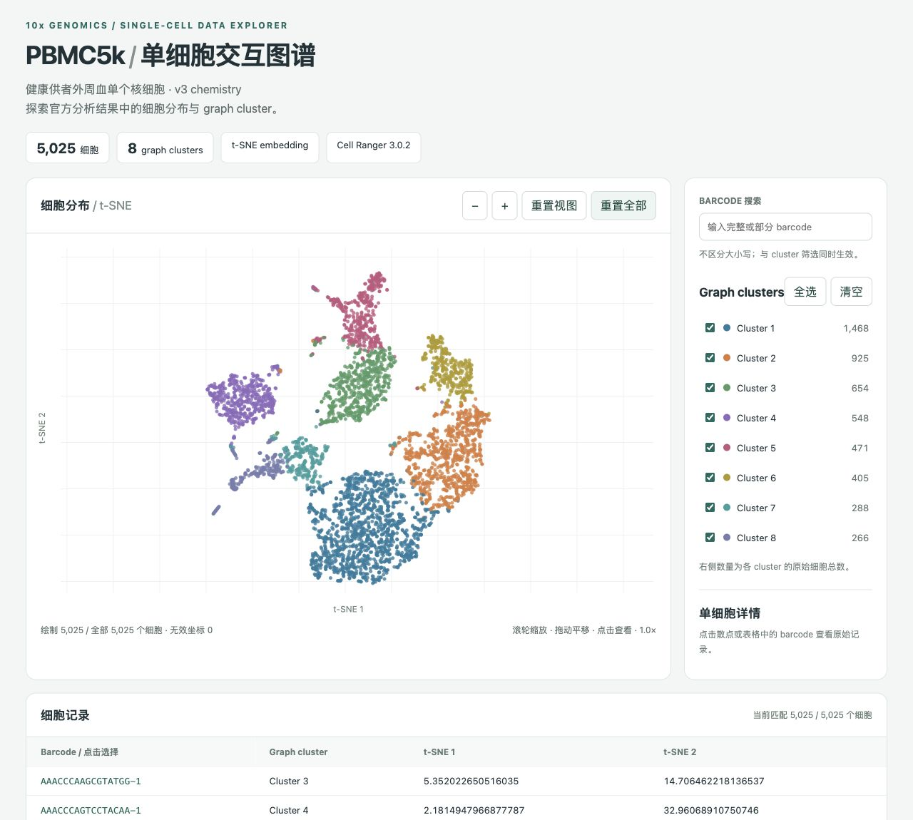

完整页面包含 5,025 个细胞和 8 个 graph cluster。支持 cluster 多选、barcode 搜索、细胞详情、缩放/重置及每页 25 条的表格。此例有 t-SNE 坐标，没有 UMAP、细胞类型注释或基因表达矩阵，因此没有构造这些不存在的数据或控件。

## 1. 准备已有分析结果

数据来自 [10x Genomics：5k PBMCs，v3 chemistry](https://www.10xgenomics.com/datasets/5-k-peripheral-blood-mononuclear-cells-pbm-cs-from-a-healthy-donor-v-3-chemistry-3-1-standard-3-0-2)，官方提供 Cell Ranger 3.0.2 已分析结果，许可为 CC BY 4.0。

下载的是官方 `5k_pbmc_v3_analysis.tar.gz`，不是重新运行测序分析。准备脚本按 barcode 对齐以下两个文件，检查两边的唯一 ID 完全相等，保留所有行和原始坐标文本：

- `analysis/tsne/2_components/projection.csv`
- `analysis/clustering/graphclust/clusters.csv`

输出 [cells.tsv](../../../examples/pbmc5k/cells.tsv)，共 336,502 字节，四列：

| barcode | tsne_1 | tsne_2 | cluster |
| --- | --- | --- | --- |
| AAACCCAAGCGTATGG-1 | 5.352022650516035 | 14.706462218136537 | Cluster 3 |

数据出处、下载地址、SHA-256 和各 cluster 数量保存在 [provenance.json](../../../examples/pbmc5k/provenance.json)。未降采样，未添加细胞类型标签。

## 2. 新建“已有数据”项目

进入“所有项目 → 新建项目”，选择“已有数据 · 静态网站”，填写名称与来源说明。

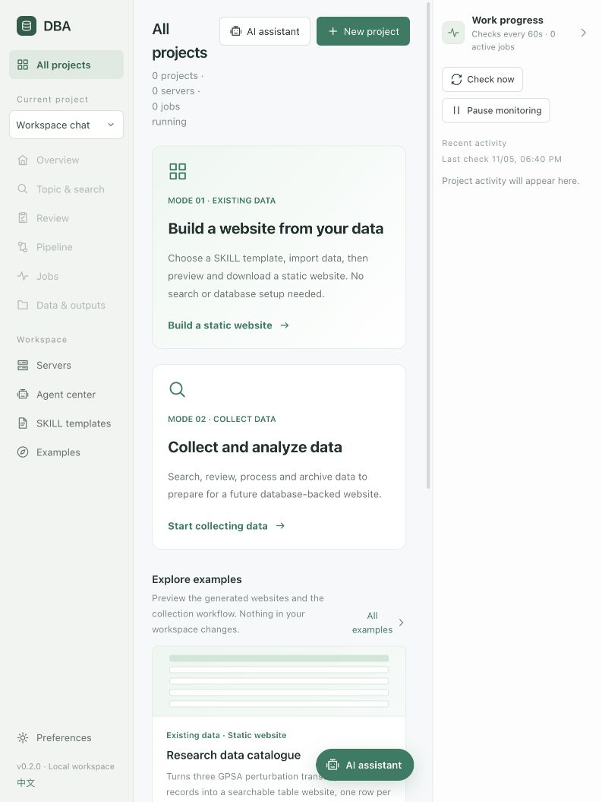

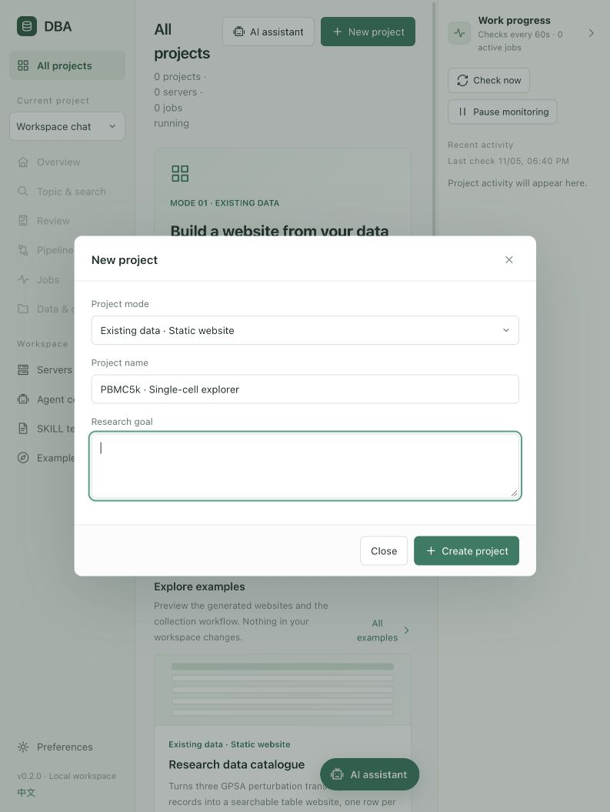

本次使用仓库的 `cmd/dba-server`，与桌面版共用业务逻辑及前端资源。测试工作空间与日常工作空间分开，现有项目没有被修改。

## 3. 安装单细胞 SKILL

新工作空间会带有 `single-cell-explorer`。已有工作空间可以在“SKILL 模板 → 导入 SKILL.md”导入 [这个文件](../../../internal/workbench/skills/single-cell-explorer/SKILL.md)。

它是领域指引，不声明固定模板。Agent 可以根据实际列名选择降维坐标、分类字段和适合的交互方式；SKILL 要求区分 cluster 与细胞类型、t-SNE 与 UMAP，以及已有分析结果和重新计算的结果。

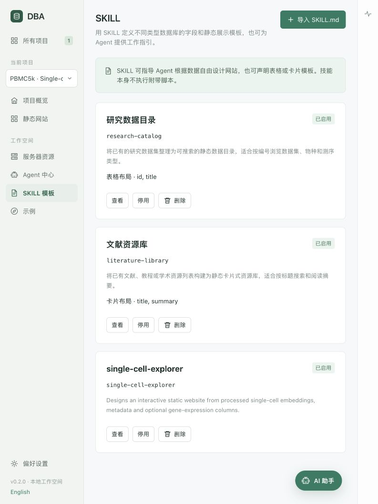

## 4. 导入并保存数据

在静态网站页导入 `cells.tsv`。文件扩展名自动选中 TSV。填写网站标题、简介，然后点击“保存数据供 Agent 建站”。自主设计不要求选择上方的固定表格模板。

保存后 DBA 会显示 5,025 行。它将数据保存为项目输入，不改变已经生成的网站快照。刷新页面后输入会以等价 JSON 显示，这是持久化恢复的格式，不代表原数据被改写。

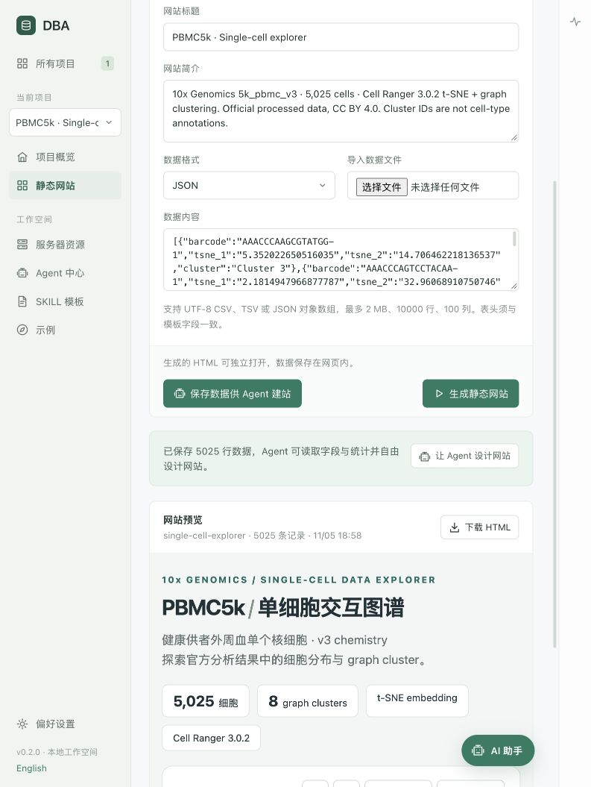

## 5. 给 Agent 一个目标

点击“让 Agent 设计网站”，发送如下要求。本次模型由已有本地服务提供，页面生成没有调用外部部署插件。

> 使用 $single-cell-explorer。这是已导入的 10x Genomics 5k_pbmc_v3 官方 Cell Ranger 3.0.2 分析结果，5,025 个细胞，t-SNE 坐标和 graph cluster；没有细胞类型注释或基因表达矩阵。请先读取 skill 和数据统计，自主设计并通过 build_custom_site 实际保存一个适合对外分享的单细胞交互网站。希望能查看散点图、cluster 图例和筛选、barcode 搜索、单细胞详情、缩放/重置以及可分页的细胞表，布局和视觉风格由你根据数据决定。请保留所有细胞，不要生成假数据。页面注明 10x Genomics、CC BY 4.0 和官方来源。不要部署到外网。保存后核对行数，我会在浏览器实际测试。

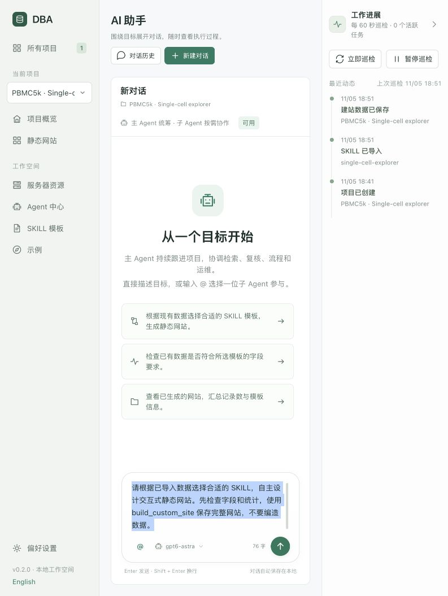

成功执行实际经历了五次工具调用：

1. `read_skill`：读取单细胞领域指引。
2. `inspect_site_data`：读取字段、数值范围、缺失数、分类计数和少量样例。
3. `get_static_site`：检查当前是否已有网站。
4. `build_custom_site`：提交 Agent 自己写的 HTML/CSS/JavaScript。
5. `get_static_site`：核对保存结果。

网站代码通过 `window.DBA_DATA` 读取完整表。Agent 不必将 5,025 行数据重新抄写进代码；本次生成的页面源码为 15,713 字节。独立导出时，DBA 会嵌入全量数据和 CSP。

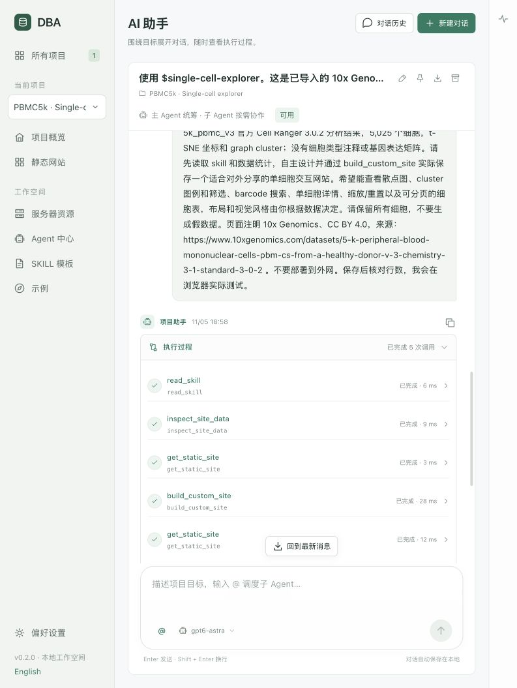

Agent 如实说明自己没有浏览器工具，不能把“保存成功”当成“交互已验证”。随后由本次 walkthrough 的浏览器操作完成交互检查。

## 6. 操作网站并核对结果

| 实际操作 | 观察结果 |
| --- | --- |
| 初始打开 | 绘制 5,025 / 全部 5,025，8 个 cluster，无效坐标 0 |
| 清空筛选，仅勾选 Cluster 1 | 散点和表格均为 1,468 个细胞 |
| 保持 Cluster 1，搜索一个属于 Cluster 3 的 barcode | 显示 0 个匹配细胞 |
| 全选 cluster，用小写 barcode 搜索 | 唯一匹配，不区分大小写 |
| 点击表格中的 barcode | 详情显示原始四个字段，数值与输入一致 |
| 直接点击散点 | 选中 `CCTTCAGTCCCGTGAG-1`，坐标与输入一致 |
| 点击放大，再重置视图 | 1.0× → 1.3× → 1.0× |
| 重置全部 | 搜索与筛选恢复，重新显示 5,025 个细胞 |
| 点击下一页 | 第 2 / 201 页，每页 25 条 |
| 重启 DBA 再打开 | 网站快照与 5,025 行输入仍在，图谱正常加载 |

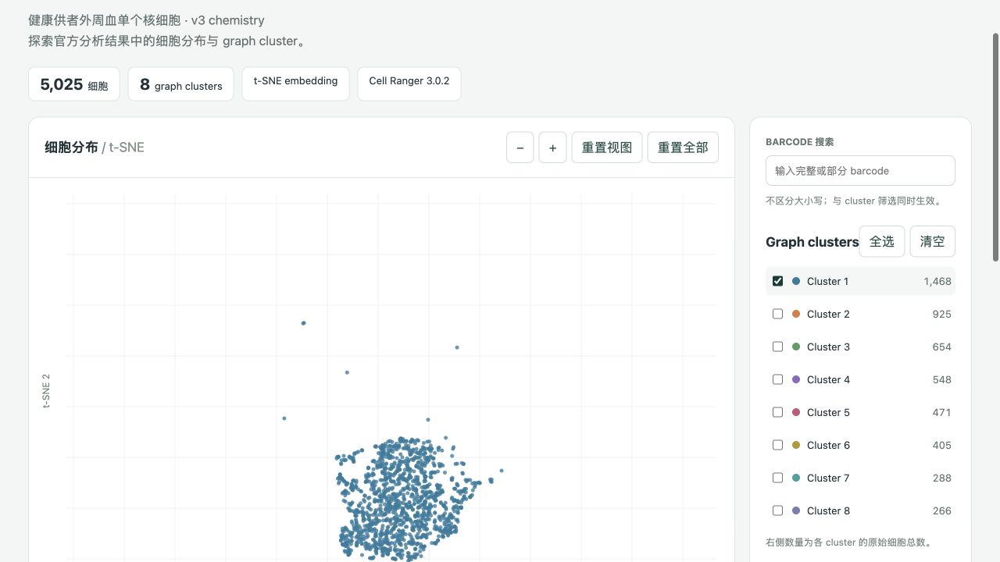

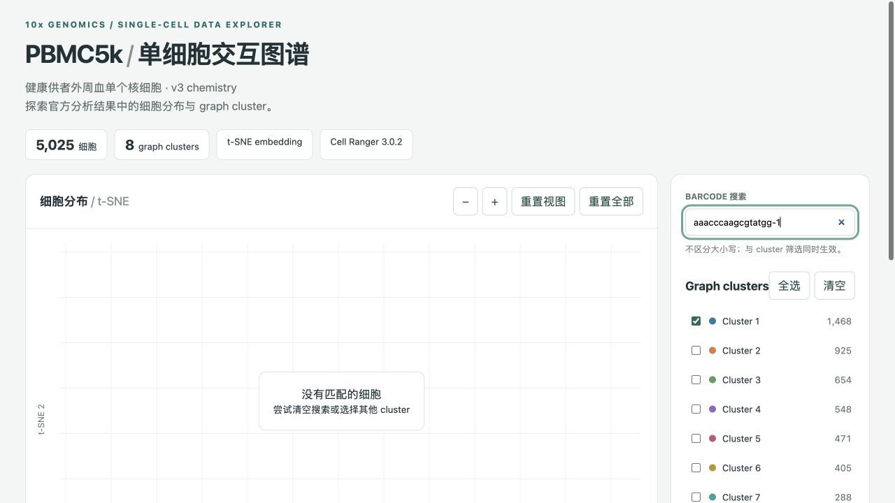

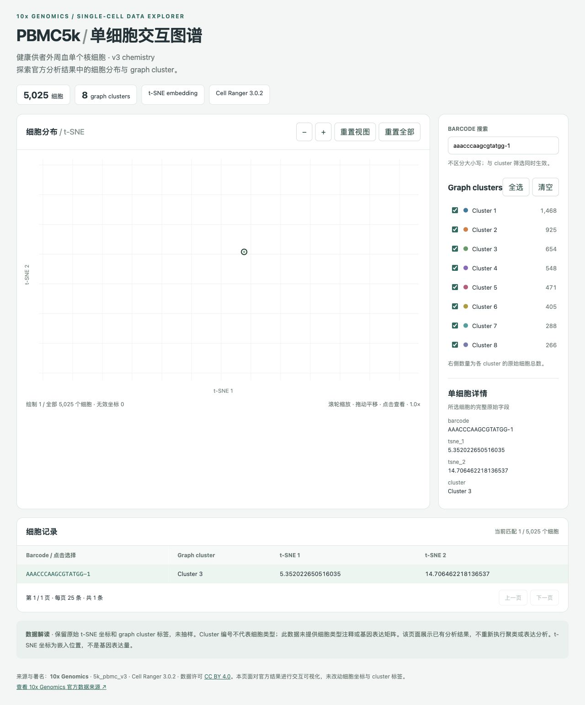

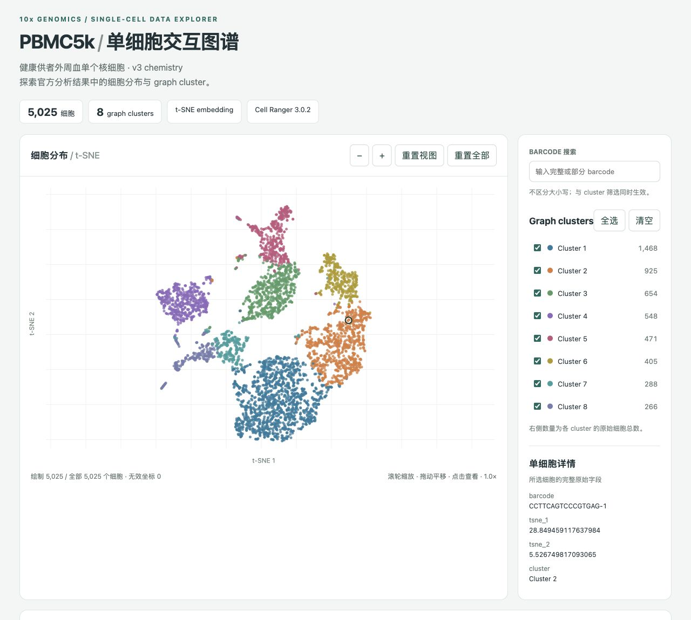

测试过程中浏览器未记录 error/warning。滚轮、拖动及所有键盘组合未逐一穷举，不能把这次结果推广为所有未来 Agent 生成页面都无误。

## 7. 下载用于分享的 HTML

回到 DBA 静态网站页，点击“下载 HTML”。本次实际下载的文件保存为 [index.html](index.html)，大小 **403,055 字节**。其中的 5,025 行、4 列与项目输入逐项一致，两个内嵌脚本均通过 JavaScript 语法检查。

文件包含页面代码和数据，可交付给用户或上传到选定的静态托管服务。没有发布外网，也没有配置数据库、应用服务器或登录系统。分享这个 HTML 就会同时分享其中的全部细胞数据。

**独立打开的验证限制：** 浏览器工具拒绝 `file://` 协议，因此本次没有完成直接双击文件的离线浏览器测试。已验证的是 DBA HTTP 预览中的实际交互、下载动作、导出文件完整性及内嵌代码。离线打开仍需在普通浏览器中手动确认。

## 实测发现及修复

| 问题 | 证据与处理 |
| --- | --- |
| 文件导入后无法生成 | 页面重绘试图把非空路径回填给 `input[type=file]`，触发浏览器异常。现在文件框不参与草稿缓存和回填，导入内容仍会保留。 |
| pbmc5k 超过旧行数上限 | “5k”实际有 5,025 个细胞，旧版拒绝。上限调整为 10,000 行，保留 2 MiB、100 列限制，没有截掉最后 25 个细胞。 |
| 原模型 ID 返回 404 | 仅将隔离测试实例的 `Gpt6-astra` 改为服务返回的 `codex/gpt-6-astra`；日常实例未改动。 |
| 完整网页生成超过 90 秒 | 模型请求改为 5 分钟超时并保留取消；检索仍为 90 秒。重试后成功，成功记录保留在 Agent 对话中。 |

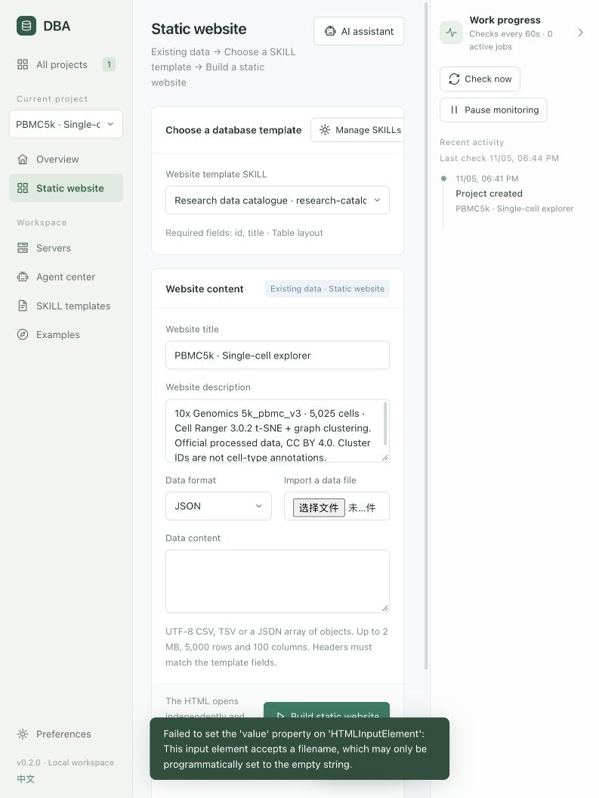

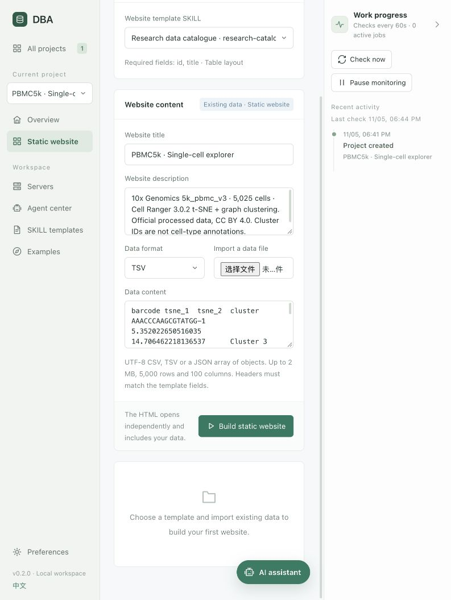

代码验证：`go test ./...`、`go test -race ./internal/workbench`、`go vet ./...`、前端 15 项测试及 i18n 检查通过。新增后端测试覆盖全量注入、输入与网站快照分离、失败重建回滚、重启保留、技能停用/删除、脚本闭合字符串转义和行数边界。SKILL 已通过 DBA 的真实 YAML 解析与导入；通用 Python skill 校验器因本机缺少 PyYAML 未运行。

## 本次能力范围

此次增强面向**用户已分析好的数据结果**。通用工具允许不同领域的 SKILL 指导 Agent 自主设计页面；单细胞 SKILL 是第一个真实案例。它不把 h5ad、RDS 或 FASTQ 自动变成分析结果，也不执行 SKILL 附带脚本。原始单细胞处理仍需要另一个明确配置的分析流程。
